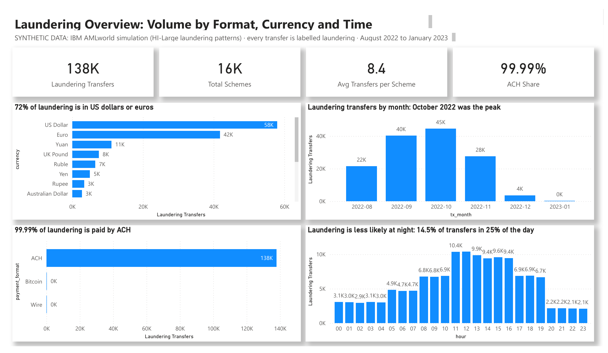
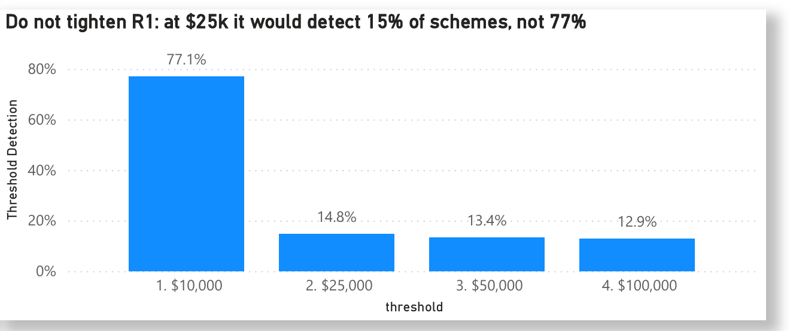

# Financial Crime Analytics: A Monitoring Rule Review

**Power BI Analysis Project · Synthetic data · IBM AMLworld**

> **Summary:** Examination of simulated financial transaction data to identify money laundering patterns, payment behaviours and the effectiveness of monitoring rules.

[🌐 Project page](https://cjsmith-page.github.io/analysis/03-financial-crime/) · [📊 Dashboard (PDF)](dashboard/Financial_Crime_Dashboard.pdf) · [📄 Project brief](docs/Project_Brief.md) · [🧾 SQL](sql/Amlrulesanalysis.sql)

---

## At a Glance

| | |
|---|---|
| **Problem** | Monitoring rules have to catch laundering without burying analysts in alerts that lead nowhere. |
| **Finding** | Six rules detect 97.2% of 16,467 schemes, but two network rules raise 8.3 alerts per scheme while catching almost nothing unique. |
| **Recommendation** | Retire three rules: 37% fewer alerts for less than one point of detection (97.2% to 96.3%). |

**Scope:** IBM AMLworld (synthetic) · 137,936 laundering transfers · 16,467 schemes

## The Business Problem

Transaction monitoring rules raise alerts that analysts must review. Too few rules miss laundering; too many bury the team in alerts that lead nowhere. Every rule has to earn its place.

The project brief defined four stakeholders and what each needs: the head of financial crime operations (fewer alerts), analysts (alerts worth reviewing), Compliance (evidence that coverage stays high) and rule governance (a documented case for every change).

These needs became seven business questions and four KPIs: alerts, scheme detection rate, alerts per scheme and unique schemes.

## The Dashboard for Stakeholders

Four pages: the laundering overview (volume by currency, payment format, month and hour), patterns (amount bands and scheme types), rule performance (detection, alerts per scheme and unique catches for each rule) and the tuning plan with KPIs.

Every chart title states its finding, and every page is labelled as synthetic data.

## Key Findings

1. **Coverage is near complete.** Together the six rules detect 97.2% of the 16,467 schemes; most of the 460 they miss contain only one or two transfers.  
   *Implication:* little detection would be lost by simplifying the rule set.
2. **Two rules do most of the work.** The foreign-currency rule detects 82% of schemes and the $10,000 large-transfer rule 77%, and each catches hundreds of schemes no other rule does.  
   *Implication:* these are the rules to protect.
3. **Network rules are costly.** The many-senders and many-receivers rules raise 8.3 alerts for every scheme they detect, yet each catches only 17 schemes that no other rule catches.  
   *Implication:* they add analyst workload with almost no unique value.
4. **There is no evidence of structuring.** Transfers just below $10,000 are no more common than transfers in any other $1,000 band.  
   *Implication:* a structuring rule has nothing to catch in this data.
5. **Laundering happens mostly by day.** Only 14.5% of laundering transfers occur at night, a period covering a quarter of the day.  
   *Implication:* a night-time rule is unlikely to be efficient.

## Rule-Tuning Plan

1. **Retire the network rules (R3 and R4).** Together with the structuring rule, this cuts alerts by 37% while scheme detection falls by less than one point, from 97.2% to 96.3%.  
   *Addresses finding 3 · **Measure:** total alerts and scheme detection rate.*
2. **Retire the structuring rule (R2).** There is no structuring to catch.  
   *Addresses finding 4 · **Measure:** detection rate after removal.*
3. **Keep the large-transfer threshold at $10,000.** Raising it to $25,000 would cut the rule’s detection from 77% to 15%.  
   *Addresses finding 2 · **Measure:** detection rate of the large-transfer rule.*
4. **Test the broad rules for false alerts.** Run the night-time and foreign-currency rules on the full transactions file before relying on them.  
   *Addresses the data limitation · **Measure:** false alerts per true alert.*
5. **Track the KPIs monthly.** Hold scheme detection at 96% or more, and cut alerts per scheme by a third.  
   *Rule governance · **Measure:** detection rate and alerts per scheme.*

## How the Rules Were Tested

The analysis was built in SQLite using DBeaver, with simple SQL throughout. Each rule is one CASE statement, or a count of an account’s senders or receivers joined back to the transfers. A scheme counts as detected if any of its transfers raises an alert.

Thirteen queries follow, from what laundering looks like to each rule’s detection rate, workload and unique catches, the patterns that slip through, and the effect of tuning. Each query carries a comment stating the business question and the result.

## Understanding the Data

Real labelled laundering data cannot be published, so IBM researchers simulated a financial system and labelled every laundering transfer. I used IBM’s companion patterns file, which holds only the laundering transfers, grouped into schemes such as fan-in, fan-out and cycle.

Limitation: the file shows what each rule catches and what it costs in alerts, but not false alerts on normal payments. Measuring those on the full transactions file is the first step in the tuning plan.

Data checks caught a silent error. Some account IDs, such as 800E49350, look like numbers in scientific notation, and on the first import DBeaver read 4,419 of them as numbers, merging them into 1,862 values and inflating two rules. Importing the IDs as text fixed it, and a one-line check now confirms it on every run.

## Repository Contents

| Folder | What it holds |
|---|---|
| `dashboard/` | The Power BI dashboard: PDF, template (`.pbit`) and screenshots |
| `sql/` | The SQL behind the numbers, each query commented with its business question and result |
| `data/` | The data and the cleaned tables the dashboard reads |
| `scripts/` | A helper script to prepare the source data |
| `docs/` | The project brief and the detailed write-up |

**To open the dashboard:** open the `.pbit` file in Power BI Desktop and, when asked, point it to the files in `data/`.

**Data source:** Data: [IBM Transactions for Anti-Money Laundering](https://www.kaggle.com/datasets/ealtman2019/ibm-transactions-for-anti-money-laundering-aml) (synthetic) · Tools: SQLite (DBeaver) · Power BI

---

### Business Analysis Experience

[Collateral Discrepancy Investigation](https://github.com/CJsmith-page/ba-experience-collateral-investigation) · [SLA Performance Analysis](https://github.com/CJsmith-page/ba-experience-sla-performance) · [Screening Platform Request Delivery](https://github.com/CJsmith-page/ba-experience-screening-delivery) · [Requirements and Prototype Delivery](https://github.com/CJsmith-page/ba-experience-requirements-delivery)

### More Power BI Projects

[Consumer Complaints & Response SLA](https://github.com/CJsmith-page/powerbi-consumer-complaints) · [US Bank Consolidation & Branch Impact](https://github.com/CJsmith-page/powerbi-bank-consolidation) · [Hotel Booking Cancellations](https://github.com/CJsmith-page/powerbi-hotel-cancellations) · [Online Retail Analysis](https://github.com/CJsmith-page/powerbi-online-retail)

**Cudjoe John Smith** · Business Analyst · [Portfolio](https://cjsmith-page.github.io) · [GitHub profile](https://github.com/CJsmith-page) · [LinkedIn](https://www.linkedin.com/in/c-john-smith/)
